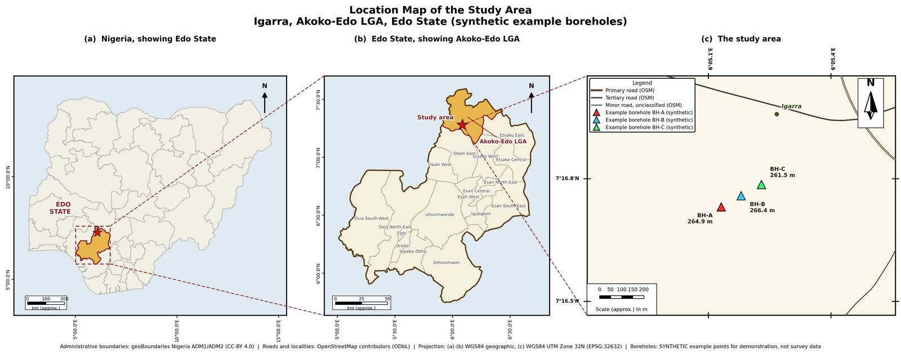
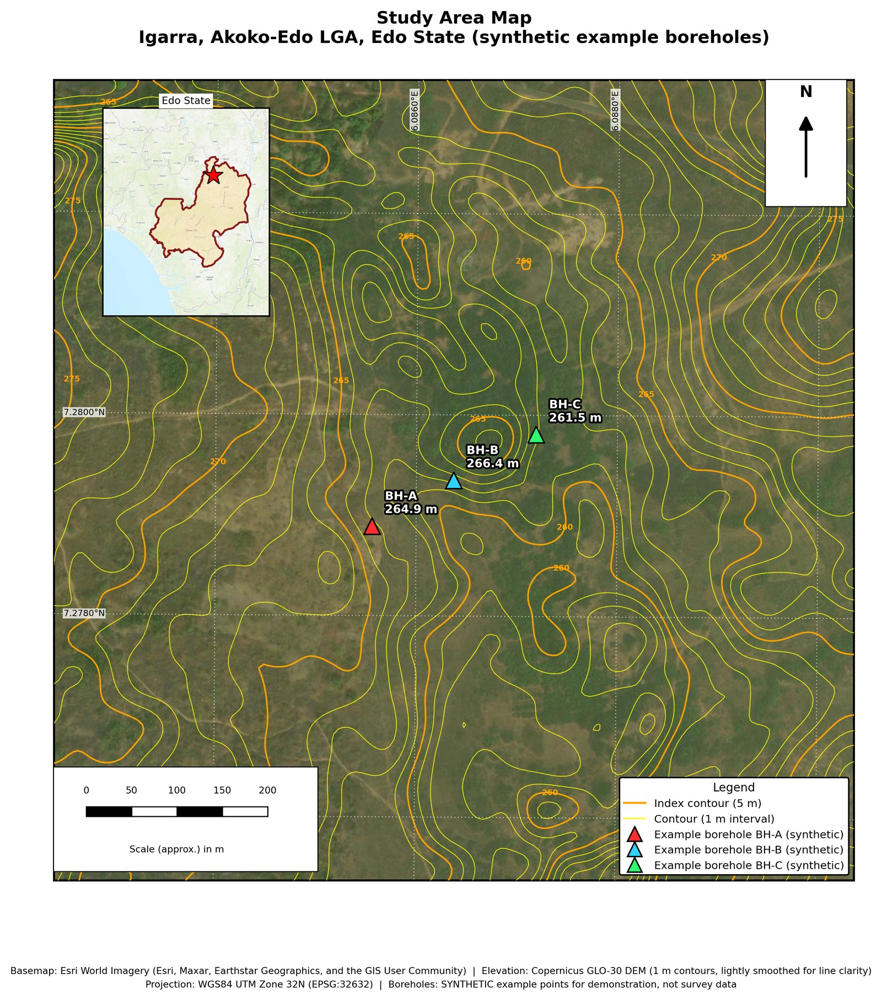
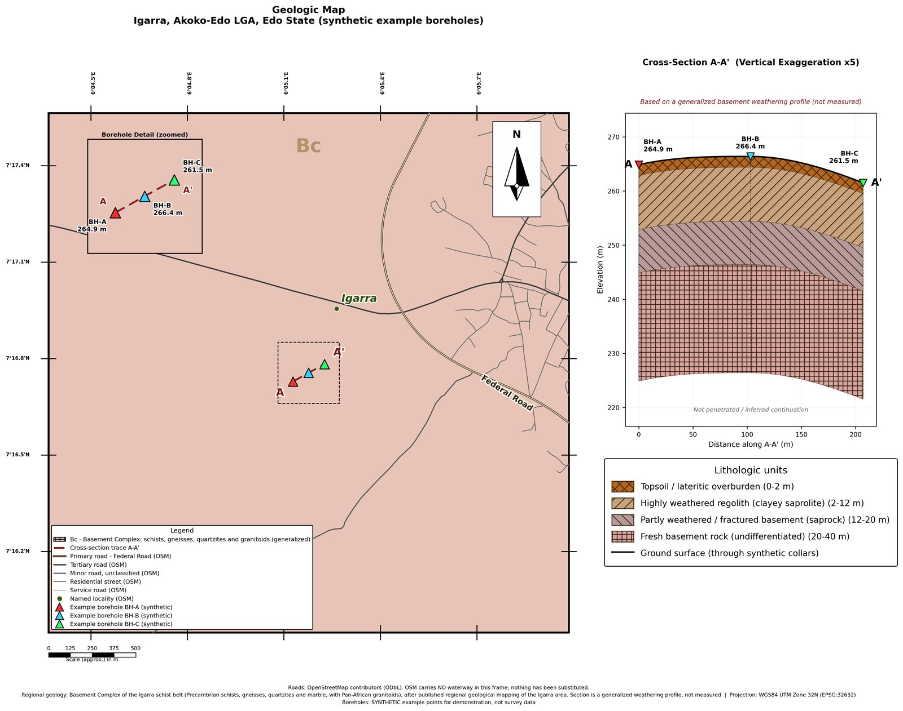

# geo-map-generator

A Python tool that turns a small borehole survey (a GPS export with a few
stations) into three 300 DPI report figures: a location map, a study area map
on satellite imagery with contours, and a geologic map with an A to A'
cross-section. It uses open data (Copernicus DEM, OpenStreetMap,
geoBoundaries, Esri imagery) and runs on the Python that ships with QGIS,
with no GIS GUI involved. Adding a site means writing a short description of
it; the projection, label placement, section scaling, legends and captions
are worked out from the data.

Author: Jubemi Pajiah, [jubemi.com](https://jubemi.com), info@jubemi.com

## Sample output

These figures come from the example site in `sites/example_igarra/`, near
Igarra, Edo State, Nigeria. **The three boreholes are synthetic.** They were
placed on open ground to demonstrate the tool and are not survey data. The
geology is a generalized draft, not measured. Click an image for the full
300 DPI file.

[](sites/example_igarra/output/location_map.png)
*Location map: Nigeria, then Edo State with its LGAs, then the site on OpenStreetMap roads.*

[](sites/example_igarra/output/study_area_map.png)
*Study area map: Esri World Imagery, 1 m contours from the Copernicus GLO-30 DEM, and the synthetic boreholes.*

[](sites/example_igarra/output/geologic_map.png)
*Geologic map: generalized surface geology over OSM roads, with a generalized A to A' weathering-profile section through the synthetic boreholes.*

## What it does

| file | what it shows |
|---|---|
| `location_map.png` | three panels: country, then state with LGAs, then the site on real road vectors |
| `study_area_map.png` | satellite imagery, topographic contours and labelled boreholes |
| `geologic_map.png` | generalized surface geology, plus the modelled A to A' cross-section |

Everything is built with GeoPandas, Rasterio, Contextily and Matplotlib.

Things a site does not have to specify, because they are derived:

- **UTM zone** from the site's own longitude. A wrong zone does not raise an
  error. It quietly distorts every distance, contour and scale bar, so it is
  computed rather than typed. (The example, at about 6.09 E, is in zone 32N.)
- **Borehole label directions** from the station geometry. Each label is
  scored so it points away from nearby stations; the middle borehole of a
  straight line gets the perpendicular.
- **A and A' end labels**, placed separately for the main map and the detail
  inset, because what they must avoid differs between the two.
- **Vertical exaggeration** from the real relief, so the section box comes out
  roughly square (see `SiteConfig.resolved_vertical_exaggeration`).
- **Road styling and the legend** from the OSM road classes actually present
  in the frame, so the legend never lists a symbol the map does not draw.
- **The source caption** from what OSM actually returned. If there is no
  locality node or no waterway in the frame, the caption says so.
- **The label of the longest named road** in frame, unless the site names one.

Any of these can be overridden by setting the field explicitly in `site.py`
(see `mapkit/config.py` for the full list).

## Quick start

With the environment set up (see "Windows and QGIS setup" below):

```bash
.venv/Scripts/python.exe make_maps.py --list                      # sites found
.venv/Scripts/python.exe make_maps.py example_igarra              # build one site
.venv/Scripts/python.exe make_maps.py example_igarra --only geologic
.venv/Scripts/python.exe make_maps.py --all                       # every site
```

Outputs go to `sites/<name>/output/`. Downloads are cached in
`sites/<name>/data/`, so re-running to adjust the cartography costs no network
traffic. Delete that folder to force a clean rebuild (the DEM tile is about
50 MB).

### Adding a site

1. Create `sites/<name>/` and put the GPS export in it as `coords.txt`. The
   parser reads the common GPS-app text export (Latitude, Longitude, Altitude,
   Accuracy, then a description line containing an ID such as `BH1` or
   `BH-A`), with or without `1.` / `2.` ordinals, and also `.xlsx` sheets with
   latitude, longitude and elevation columns. See
   `sites/example_igarra/coords.txt`.
2. Write `sites/<name>/site.py`:

```python
from mapkit import SiteConfig, BASEMENT_COMPLEX_IGARRA

SITE = SiteConfig(
    name="example_igarra",
    subtitle="Igarra, Akoko-Edo LGA, Edo State (synthetic example boreholes)",
    state="Edo",
    geology=BASEMENT_COMPLEX_IGARRA,
    synthetic_stations=True,
)
```

3. Run `.venv/Scripts/python.exe make_maps.py <name>`.

`synthetic_stations=True` is only for demonstration data. It makes every map
say in its legend and caption that the boreholes are synthetic. Leave it out
for a real survey.

Geology presets available: `BENIN_FORMATION`, `OGWASHI_ASABA_FORMATION`
(both sedimentary) and `BASEMENT_COMPLEX_IGARRA` (crystalline basement, a
draft). A preset is a small `Geology` object in `mapkit/config.py`, so adding
one for another area is a matter of writing down its units.

Note that `.gitignore` ignores everything under `sites/` except the example.
This is deliberate, so real survey data is not committed by accident.

## Data sources and licences

| data | source | licence / terms |
|---|---|---|
| Elevation | Copernicus GLO-30 DEM, via the AWS Open Data bucket (no key needed) | Copernicus DEM licence; "(c) DLR e.V. 2010-2014 and (c) Airbus Defence and Space GmbH 2014-2018 provided under COPERNICUS by the European Union and ESA; all rights reserved" |
| Roads, localities, markets, waterways | OpenStreetMap, via the public Overpass API | ODbL 1.0, (c) OpenStreetMap contributors |
| Administrative boundaries | geoBoundaries Nigeria ADM1 and ADM2 | CC BY 4.0 |
| Imagery | Esri World Imagery | Esri terms of use; attribution: Esri, Maxar, Earthstar Geographics, and the GIS User Community |

Each figure prints its own sources in its caption.

The public Overpass servers often return 429 or 504 errors. `mapkit/osm.py`
retries across three mirrors with exponential backoff, so a run that pauses
for a minute is normal.

## Data honesty

The pipeline is built not to invent things, because a map that fills a gap
plausibly is worse than one that admits it:

- Subsurface units are **generalized regional geology**, not measured at the
  boreholes, and every geologic map says so on its face.
- Borehole coordinates and elevations are plotted **exactly as supplied** in
  the station file. Where a public DEM disagrees, a caption note can report
  what the DEM reads, and the surveyed values are left alone.
- When OSM returns no named road, no locality or no waterway for a frame, the
  map draws none, the legend omits the key, and the caption states it.
- Example data is marked as synthetic on the maps themselves, not only in
  this README.

## Windows and QGIS setup

The tool uses the Python bundled with QGIS, because QGIS already provides
GDAL, PROJ, GeoPandas and the `gdal_contour` tool on Windows. Create a venv
from that Python with access to its packages, then add the two libraries QGIS
lacks. The path below is an example; use your own QGIS version and location.

```bash
"C:/Program Files/QGIS 3.40.11/apps/Python312/python.exe" -m venv --system-site-packages .venv
.venv/Scripts/python.exe -m pip install -r requirements.txt
```

`mapkit/env.py` finds QGIS by checking, in order, the `QGIS_ROOT`
environment variable, the QGIS that owns the running interpreter, and any
`C:\Program Files\QGIS *` folder. Set `QGIS_ROOT` if yours is elsewhere.

Do not `pip install` into the QGIS Python itself. Without admin rights pip
falls back to per-user site-packages, which then shadows the system NumPy and
can break pandas and pyarrow for other tools on the machine.

### Import order matters

`mapkit/env.py` works around two Windows-specific conflicts:

- rasterio's wheel bundles its own GDAL, which cannot share a process with
  QGIS's `osgeo` bindings. Nothing here may `from osgeo import gdal`.
  Contours are made by calling `gdal_contour.exe`, and GeoJSON is parsed
  directly.
- pyproj and rasterio need different `proj.db` files, so pyproj is pointed at
  QGIS's copy through its own API, and `PROJ_LIB` is deliberately left unset.

Importing `mapkit` sets this up, so **import `mapkit` before `geopandas`,
`pyproj` or `rasterio`**. If `geopandas` is imported first, a later
`.to_crs()` fails with `DLL load failed while importing _context`. The fix is
always the import order, not the CRS.

Installing rasterio into the venv can pull in NumPy 2, while QGIS's pyarrow
was built against NumPy 1. You may then see a long "A module that was compiled
using NumPy 1.x cannot be run in NumPy 2.x" message at startup. In testing it
did not stop the maps from building, but it is noisy.

## Limitations

- **Nigeria-focused boundaries.** The location map uses geoBoundaries Nigeria
  ADM1 and ADM2 and a country, state, LGA hierarchy. Sites outside Nigeria
  are not supported yet. A UK example, with generalized boundaries and a UK
  geology source such as BGS open data, is planned.
- **Generalized geology presets.** The presets describe regional geology and
  typical unit thicknesses, not what is under any given borehole. The
  `BASEMENT_COMPLEX_IGARRA` preset is a draft and its units are still to be
  confirmed. The surface geology is drawn as one unit across the frame.
- **One borehole line per section.** The cross-section follows the stations
  in ID order as a single line. Branching or multiple sections are not
  supported.
- **Windows only, for now.** Environment setup assumes a Windows QGIS install.
- **Public services.** The Overpass API and the DEM bucket must be reachable
  on the first run for each site.

## Licence

Code: MIT, see `LICENSE`. The sample figures include third-party data under
the licences listed above.
